  

 

Merhaba. Web platformları, macOS araçları ve otomasyonlar kuruyorum. Tasarımdan veritabanına, SwiftUI'dan TypeScript'e kadar işin tamamını kendim yapıyorum — ve her seferinde daha az kodla.

## Şu an

- **Nortra** — otomasyon ve mühendislik stüdyosu. Pazarlama sitesi ve panel temeli staging'de. Sırada **Scope Bot** var.
- **BareMac v0.4** — parametrik tweak'ler, uygulama içi konsol ve menü çubuğu desteğiyle alpha'da.
- **Müşteri işleri** — kurumsal siteler, yönetim panelleri ve POS/KDS sistemleri.

## Seçili işler

| Proje | Ne yapıyor | Stack |
| :--- | :--- | :--- |
| **[BareMac](https://github.com/m3rcha/bare-mac)** | macOS'u tek tıkla sadeleştiren SwiftUI aracı. Parametrik tweak'ler, canlı konsol, menü çubuğu. | `Swift` `SwiftUI` |
| **[BareMac Tweaks](https://github.com/m3rcha/baremac-tweaks)** | Topluluk tweak'leri; uygulamadan bağımsız güncellenebilen ayrı bir ekosistem. | `JSON` `Swift` |
| **[Alienware m15 R5 Hackintosh](https://github.com/m3rcha/Alienware-m15-R5-Hackintosh)** | Ventura çalışan, Wi-Fi / Bluetooth / Ethernet tam destekli EFI. | `OpenCore` `ACPI` |
| **[KRZ Medya](https://krzmedya.com)** | Kurumsal site ve yönetim paneli. | `Next.js` `TypeScript` |
| **[EAYazilim POS & KDS](https://eayazilim.tr)** | İşletmeler için satış noktası, mutfak ekranı ve yönetim paneli. | `C#` `JavaScript` |
| **[Reyhan Akgül](https://reyhanakgul.com)** | Sıfırdan yazılmış WooCommerce teması ve Aras Kargo eklentisi. | `PHP` `WooCommerce` |

Müşteri projelerinin kaynak kodu özel; bağlantılar canlı sitelere gider.

## Stack

**Diller**  
     

**Web**  
     

**Altyapı & araçlar**  
     

## Nasıl çalışırım

1. **Önce problemi netleştir.** Yanlış soruya doğru cevap yok.
2. **En küçük çalışan sürümü çıkar.** Sonra ölç, sonra büyüt.
3. **Fazlasını sil.** Her satır, her ekran, her bağımlılık kendini hak etmeli.

## Konuşalım

Yeni bir ürün, bir otomasyon fikri ya da macOS tarafında bir şey mi var? GitHub üzerinden yazabilirsin.

[**GitHub**](https://github.com/m3rcha) · [**BareMac**](https://github.com/m3rcha/bare-mac) · [**Hackintosh EFI**](https://github.com/m3rcha/Alienware-m15-R5-Hackintosh)

<strong>English</strong>

 

I build products from scratch — web platforms, macOS tools, and automations. From design to database, from SwiftUI to TypeScript, I do the whole thing. Then I delete everything that doesn't earn its place.

**Now:** Nortra (automation & engineering studio), BareMac v0.4 (parametric macOS tweaks), and client work.

**Selected work:** BareMac · BareMac Tweaks · Alienware Hackintosh EFI · KRZ Medya · EAYazilim POS & KDS · Reyhan Akgül WooCommerce.

**How I work:** define the problem, ship the smallest working version, measure, then grow. Simplicity is a feature.

[GitHub](https://github.com/m3rcha) · [BareMac](https://github.com/m3rcha/bare-mac)

---

  sıfırdan kuruldu · fazlası silindi · son güncelleme: Kasım 2026

